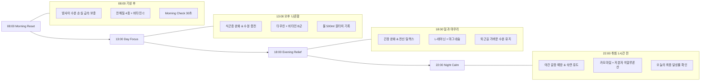
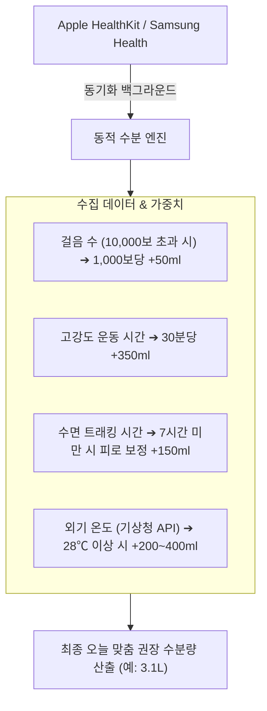

# Circadian Hydration Platform - 제품 패키지 연동 QR 시스템 및 서카디언 저니 상세 기획서

---

## 1. 개요 및 핵심 차별화 전략

### 기존 수분 트래커 앱의 한계
- **단순 기록의 피로감**: 단순히 "물 몇 잔 마셨는지"만 입력하게 하여 3일 이내 이탈률 70% 초과.
- **제품과의 단절**: 수분 섭취 앱과 실제 마시는 제품(기능성 워터, 전해질, 차 등) 간의 연결고리 부재.

### Circadian Hydration Platform의 해결책
1. **QR 기반 피지컬-디지털 연결 (Phygital Loop)**:
   - 제품 패키지를 언박싱하자마자 QR 스캔을 통해 "나만의 24시간 서카디언 루틴"이 즉시 시작됨.
2. **Hydration Score™ 독자 지표**:
   - 수분량뿐 아니라 수면 리듬, 소변 색상, 갈증/입마름 체감도를 종합한 100점 만점 독자 브랜드 스코어.
3. **서카디언 저니 (Circadian Journey)**:
   - 생체 시계(08:00 Morning ➔ 13:00 Day ➔ 18:00 Evening ➔ 22:00 Night)에 맞춘 제품 추천 및 섭취 가이드.
4. **데이터 기반 재구매 D2C CRM**:
   - 7일/30일 수분 리포트 기반 "가장 수분이 부족했던 시간대"의 제품 리필 추천 및 자동 정기배송 전환.

---

## 2. 제품 패키지 연동 QR 온보딩 플로우

```mermaid
sequenceDiagram
    autonumber
    actor User as 고객 (구매자)
    participant Box as 제품 패키지 (QR)
    participant Web as 웹/앱 온보딩
    participant API as Circadian API
    participant CRM as D2C CRM 엔진

    User->>Box: 제품 배송 수령 및 언박싱
    User->>Box: 스마트폰 카메라로 QR 스캔
    Box->>Web: 랜딩 페이지 오픈 (토큰 및 제품코드 포함)
    Web->>API: POST /api/v1/qr/scan (정품 인증 & 루틴 활성화)
    API-->>Web: 제품 정보, 환영 메시지, 15% 리필 쿠폰 반환
    Web->>User: "아침 30초 체크하고 나만의 수분 스코어 확인" 모달 노출
    User->>Web: 30초 Morning Check 완료
    Web->>API: 스코어 산출 & 오늘 권장량 계산
    API-->>Web: Hydration Score (82점) & 시간대별 섭취 가이드 제공
    API->>CRM: 1일차 루틴 개시 이벤트 등록 (Day 7, Day 25 리필 트리거 예약)
```

### QR 코드 구조 및 파라미터 설계
```text
https://circadian.kr/routine?p=MORNING_RESET&batch=202610A&token=a8f9c1e2
```
- `p` (제품 코드): `MORNING_RESET`, `DAY_FOCUS`, `EVENING_RELIEF`, `NIGHT_CALM`
- `batch` (제조 배치): 유통기한 및 생산 배치 추적
- `token` (고유 난수): 정품 인증 및 단일 고객 최초 온보딩 리워드 증정

---

## 3. 서카디언 저니 (Circadian Journey) 24시간 상세 매핑



| 시간대 | 단계 | 생체 상태 특징 | 최적 수분 및 영양 솔루션 | 푸시 알림 카피 문구 |
| :--- | :--- | :--- | :--- | :--- |
| **08:00** | **Morning Reset** | 밤새 호흡/땀으로 약 300~500ml 수분 손실, 혈액 점도 상승 | 미온수 350ml + 흡수 빠른 전해질 & 비타민 C | "좋은 아침! 밤새 마른 몸을 깨워보세요. 30초 체크로 오늘 스코어를 확인하세요." |
| **13:00** | **Day Focus** | 점심 식후 혈당 변동 및 식곤증, 오후 업무 집중력 저하 | 시원한 물 500ml + 타우린, 비타민 B군, 과라나 | "나른한 오후 1시! 시원한 물 500ml와 Day Focus로 번아웃 없는 활력을 충전하세요." |
| **18:00** | **Evening Relief** | 하루 근무로 누적된 피로, 근육 긴장 및 탈수 | 상온수 300ml + L-테아닌, 타트체리, 칼륨/마그네슘 | "퇴근길, 하루 동안 고생한 나를 위해 Evening Relief로 편안한 밸런스를 맞춰주세요." |
| **22:00** | **Night Calm** | 수면 준비 상태, 야간 빈뇨 방지하면서도 목마름 예방 | 따뜻한 물 200ml + 카모마일, 락티움, 글리신 | "오늘 하루 수분 목표 82% 달성! 부담 없는 Night Calm 한 잔으로 편안한 밤을 맞이하세요." |

---

## 4. D2C 전환율 극대화 CRM 시나리오 (Retention & LTV)

### (1) Day 1 ~ 3: 온보딩 안착 단계
- **목표**: 30초 아침 체크 3일 연속 달성
- **CRM 혜택**: 3일 연속 체크 완료 시, 오후 집중용 'Day Focus' 1회분 샘플 쿠폰 자동 지급.

### (2) Day 7: 첫 번째 주간 수분 분석 리포트
- **목표**: 개인화된 취약 시간대 피드백 및 교차 판매
- **데이터 분석 예시**:
  - *"고객님은 오전 수분 섭취는 90% 이상 우수하지만, **오후 2~5시 사이 수분 섭취가 급격히 떨어지는 패턴**이 관찰되었습니다."*
  - *"오후 피로 시간대를 보완해주는 **Day Focus 30일 루틴 팩 20% 특별 할인권**을 선물해 드립니다."*

### (3) Day 25: 소진 시점 스마트 리필 알림 (Predictive Refill)
- **목표**: 재구매 주기 단축 및 정기구독(Subscribe & Save) 전환
- **트리거**: 1박스(30포) 기준 25일차 도달 시 알림
- **카피**:
  - *"Morning Reset이 5포 남았어요! 끊김 없는 서카디언 루틴 유지를 위해 정기배송을 신청하시면 매월 15% 추가 할인과 무료 배송 혜택을 드립니다."*

---

## 5. Apple Health & Samsung Health 자동 연동 알고리즘 규격


- 스마트폰 및 스마트워치 센서가 실시간으로 수분 요구량을 자동 보정하여 사용자가 별도로 계산할 필요 없이 신뢰성 높은 권장량을 제시합니다.
